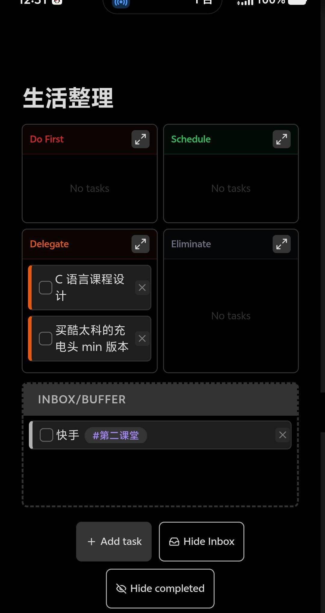
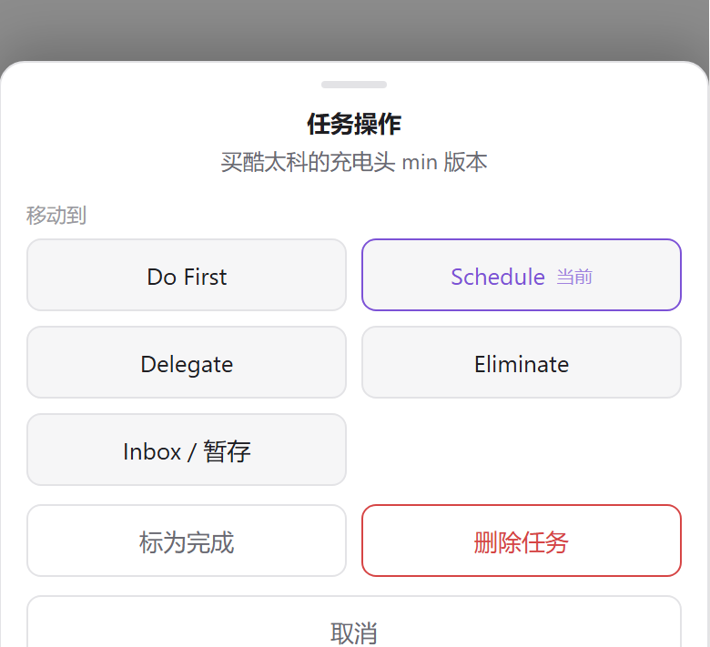
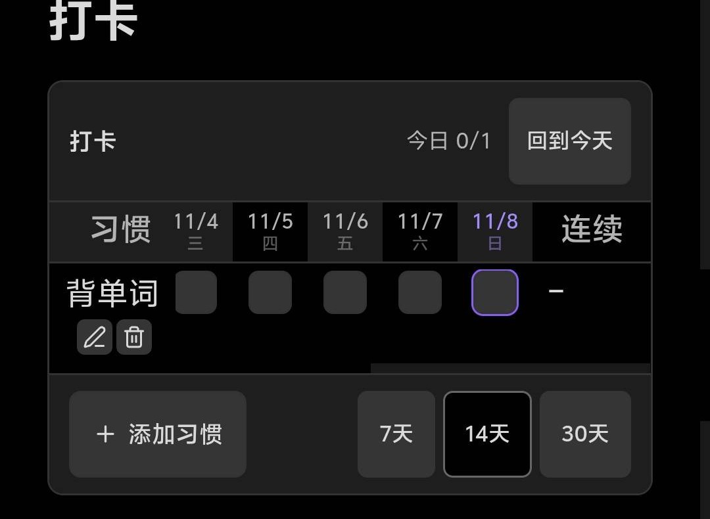

用 Obsidian 久了会发现一个矛盾：**越是想认真用的功能，越容易被做成插件数据库**。待办存在 `data.json`，打卡存在 `data.json`，看着挺好用，但一旦想换工具、想在手机上直接改一条、想让 `git log` 留下记录，就卡住了。

所以这半年陆陆续续把两件事做成了**代码块**：四象限待办和习惯打卡。数据就是笔记里的几行 markdown，插件只负责把它们渲染成能点的界面。今天把这两个插件整理开源了：

- [obsidian-quadtasks-enhanced](https://github.com/dongyue12/obsidian-quadtasks-enhanced) — 四象限待办
- [obsidian-checkin-grid](https://github.com/dongyue12/obsidian-checkin-grid) — 打卡格子

两者都适配了手机端，都能和同步插件配合，下面说说怎么用、为什么这么设计。

## 一、四象限待办：QuadTasks Enhanced



这是在自己手机上截的图，不是示意图。四个象限、Inbox、底部按钮都在一屏内，任务文字正常横排。

### 写法就是普通清单

在笔记里插一个 `eisenhower` 代码块（`eisen`、`todoeh` 也行）：

````markdown
```eisenhower
- [ ] (urgent-important) 交课程设计报告
- [ ] (not-urgent-important) 买充电头 min 版
- [ ] (urgent-not-important) 回复群通知
- [x] (not-urgent-important) 备份笔记
- [ ] (buffer) 快手 #第二课堂
```
````

五个标记对应五个去处：

| 标记 | 显示在 | 含义 |
|---|---|---|
| `urgent-important` | Do First | 紧急且重要 |
| `not-urgent-important` | Schedule | 重要不紧急 |
| `urgent-not-important` | Delegate | 紧急不重要 |
| `not-urgent-not-important` | Eliminate | 都不沾 |
| `buffer` | Inbox | 还没想好，先扔这儿 |

任务正文是普通 markdown，`**加粗**`、`[[双链]]`、`#标签` 照样渲染。上面那个 `#第二课堂` 就是标签，渲染成紫色小胶囊。

### 快在哪

- **换象限**：电脑上直接拖；手机上长按 450ms 弹出面板，五个去向一键选，当前所在象限会标「当前」。
- **做完一条**：点左边的复选框，立刻写回文件，不用切源码模式。
- **不想看已完成的**：底部 `Completed (1)` 点一下全部展开，再点收起。**这个开关只影响显示**，文件里一行都不会少——这比原版的 `Clear completed` 安全得多，后者是真的从文件里删掉。
- **Inbox 默认收起**：底部只显示 `Inbox (1)` 这样的计数，有暂存任务才提醒，不白占版面。
- **单象限聚焦**：象限右上角的 ↗ 把它放大到整行，杂事多的时候只看一块。



手机上没有 hover、也没有 HTML5 拖拽，所以长按是唯一的换象限入口。手指移动超过 10px 就判定成滑动，不会误弹；长按之后浏览器补发的那次 click 会被吃掉，也不会误勾选。

### 移动端踩过的坑

第一版到手机上惨不忍睹：任务文字变成**一个字一行**的竖排，卡片整体向右偏，右半边被象限切掉。查下来是两件事叠加：

1. Obsidian 给 `ul` 默认加了 `padding-inline-start: 40px`，卡片右移后宽度溢出，被象限的 `overflow: hidden` 裁掉；
2. 主题和 Obsidian 默认样式对 `li` / `p` 的优先级比插件样式高，文字列被压到约一个字宽。

靠 `styles.css` 加选择器压不住。最后的解法是把关键约束**以 `!important` 内联写到元素上**——网格列宽钉成 `minmax(0, 1fr) × 2`，卡片 `box-sizing: border-box`、`width: 100%`，文字容器强制块级横排。内联样式的优先级高于任何样式表，主题再怎么改也推不动。

顺带修掉一个隐藏问题：删除按钮 `×` 原本是 `:hover` 才显示的，触屏根本没有 hover，等于手机上删不掉任务。现在触屏常显半透明。

## 二、打卡：Checkin Grid



打卡也存在笔记里，一行一个习惯：

````markdown
```checkin
- 背单词 | 2026-11-05, 2026-11-06
- 到梦空间活动
```
````

`checkin`、`daka`、`打卡` 三种代码块名都认。竖线后面是打卡日期，可以完全省略（等于一次都没打）。

### 快在哪

- **点格子就打卡**，再点一下取消，日期立刻写回文件。
- **默认停在今天**：打开笔记自动滚到最右一列，今天永远在视野里，不用横滑找。「回到今天」随时复位；你手动滑过之后它就不再抢位置。
- **不用切源码模式**：点习惯名（或悬停出现的铅笔）就能就地改名，Enter 保存、Esc 取消，重名会被拦下；垃圾桶图标删习惯，带二次确认，还会告诉你有几天记录一起没了。
- **7 / 14 / 30 天窗口**切换，选择会记住。
- **右侧自动算连续天数**，断一天归零；还有当前窗口的完成率（窄屏会隐藏这列，把宽度全让给格子）。

手机上的格子放大到了 22–24px，手指点不容易点错；横向滚动时左侧「习惯」列固定不动，不会滚到一半认不出哪行是哪行。

## 三、和同步插件一起用，才是完整形态

这两个插件真正的价值在和同步插件（我用的是一套基于 git 的 `vault-sync-git`）配合之后才显出来，因为它俩的数据**都是笔记正文**：

- 手机上勾一条待办、打一个卡 → 电脑上打开就是最新的；
- 反过来在电脑上整理象限、改习惯名 → 手机重载后同样生效；
- 全部走 git，哪天想回滚，`git log` 里能看到具体哪一行变了；
- 就算哪天把插件删了，`待办.md` 和 `打卡.md` 还能当普通清单用。

对比之下，数据存在插件 `data.json` 里的方案，同步时是个黑箱：冲突了只能二选一，也没法用 `git diff` 看出到底改了什么。

两个实践中的注意点：

1. **插件代码同步过去后要重启 Obsidian**。切笔记、下拉刷新都不会重新加载 `main.js`，必须彻底退出重开（或 `Ctrl+R`）。
2. 桌面端改完插件的 `main.js` / `styles.css`，等同步插件把**两个文件都**推上去再在手机上试。我踩过一次：`main.js` 先同步了，`styles.css` 还在队列里，手机上就出现「按钮是新的、样式还是旧的」——所以后来干脆把布局关键约束内联进 JS，不再依赖 CSS 是否同步到位。

## 安装

两个插件都没上 Obsidian 官方商店，手动装三步：

1. 到 Releases 页面下载 `main.js`、`manifest.json`、`styles.css` 三个文件
   - [QuadTasks Enhanced 最新版](https://github.com/dongyue12/obsidian-quadtasks-enhanced/releases/latest)
   - [Checkin Grid 最新版](https://github.com/dongyue12/obsidian-checkin-grid/releases/latest)
2. 分别放进：
   - `<你的库>/.obsidian/plugins/quadtasks/`
   - `<你的库>/.obsidian/plugins/checkin-grid/`
3. 重载 Obsidian（`Ctrl+R`），到 设置 → 第三方插件 里启用

**文件夹名必须和 `manifest.json` 里的 `id` 一致**，否则 Obsidian 不加载。如果你装过原版 QuadTasks，直接覆盖这三个文件即可——插件 id 仍是 `quadtasks`，笔记格式完全兼容。

## 已知限制

说实话的部分：

- `Clear completed` 仍然是**真删**，不归档、不提示。想留记录就别点它，用 `Completed` 开关把已完成藏起来就够了。
- 触屏不支持拖拽换象限（用长按面板代替）。
- 打卡只记「打没打」，没有「每周三次」这类目标，也不能自由翻看上个月。
- 两个插件界面文案都是英文（Do First / Schedule / Delegate / Eliminate），这点没跟着翻译。

## 关于开源

两个项目都是 MIT。QuadTasks Enhanced 是基于 [SiranHQ/obsidian-QuadTasks](https://github.com/SiranHQ/obsidian-QuadTasks)（作者 Parth Sidpara，MIT）改的，原仓库的 LICENSE 与版权声明都保留了，改动清单写在 README 和 CHANGELOG 里。

都是没有构建步骤的纯 JS，`main.js` 就是可直接加载的产物，改完 `node --check main.js` 校验一下就能用。有 bug 或者想要的功能，直接开 issue。
